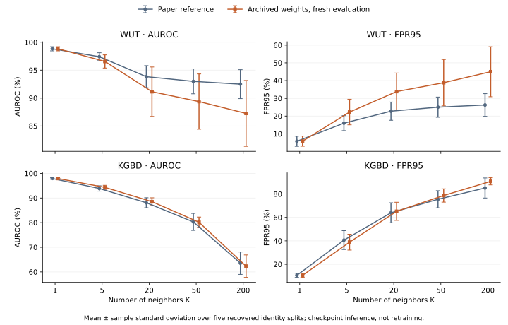

# Release validation

GPU benchmark validation: 2026-11-12. Recorded CPU regression validation:
2026-11-13 (Asia/Tokyo). Model scores below were calculated from data and weights,
rather than copied from checkpoint score fields. Reference values are recorded
separately in [paper_targets.json](config/paper_targets.json).

## Scope of the recorded measurements

The training and GPU measurements below were collected on 2026-11-12 using the
**previous fixed-seed version**. The source now generates run seeds by default.
These historical records and their JSON files remain unchanged; the full
training benchmark has **not been rerun under the new random-seed defaults or
the subsequent temporal-eigenbasis determinism fix**. The existing scores remain
measurements of the recorded training runs and checkpoints.

The initial GitHub Actions run exposed a seed-replay failure with SciPy 1.17:
the temporal Laplacian's sparse eigensolver used an unseeded initialization.
New model construction now uses NumPy's dense symmetric eigensolver for this
small graph, removing that source of randomness. Model dimensions and checkpoint
keys are unchanged. Loading a saved `time_pe` buffer restores its recorded values,
so this correction does not replace the temporal encoding in existing weights.
The earlier full-dataset measurements do not validate retraining with the fix.

Because the source code now uses randomly generated seeds by default, results may differ slightly from those reported in the paper.

The difference is not guaranteed to be small: data selection, sampling, software
versions, and hardware also influence the numerical results.

## Training from scratch with the previous fixed-seed version

The recorded runs used the final published Algorithm 2 and adopted seed 42.
Training and independent selected-checkpoint evaluation are recorded separately.
No seed or hyperparameter was selected by searching for the paper's target scores.

| Run | Paper R1 / R5 / mAP (%) | Independently evaluated R1 / R5 / mAP (%) | Status |
| --- | --- | --- | --- |
| KS20 N=6 | 75.2 / 92.7 / 55.0 | **73.3945 / 89.9083 / 54.1295** | Completed; patience 500 |
| WUT 5C N=6 | 80.2 / 90.2 / 59.0 | **79.9266 / 89.9633 / 59.5832** | Completed; epochs 0–1000 |
| KGBD N=6 | 61.7 / 75.7 / 25.5 | **68.1614 / 80.1848 / 30.7223** | Completed; epochs 0–200 |

KS20 selected epoch 208 and stopped at the evaluation of epoch 708 after 500
non-improving evaluations. Training took 563.86 seconds. Independent evaluation
uses the captured spatial eigenbasis and matches every stored metric exactly.
See the [evaluation record](docs/verification/ks20_n6_fresh_training.json) and
[paper comparison](docs/verification/ks20_n6_training_comparison.json).

WUT used all 25 training identities and no unknown split, completed all 1,001
epochs in 4,805.71 seconds, and selected epoch 875. Independent evaluation exactly
matches the saved R1/R5/R10/mAP values. Source snapshots, prepared-data hashes,
finite model tensors, and use of the captured spatial encoding were verified.
The probe contains 24 identities: Julia (original ID 3) has no valid probe
windows under the recovered split, as detailed in the data protocol.
The seven Algorithm 2 checks all kept lambda at 0.5; this run does not establish
a measured benefit from changing the dynamic weight. Its
[evaluation](docs/verification/wut_n6_fresh_training.json) and
[complete training audit](docs/verification/wut_n6_training_comparison.json)
retain the full-precision scores and update events. The earlier interrupted run
is a local partial code check and is not used for these results.

KGBD completed the fixed validation budget of epochs 0–200 with patience 500,
chosen before training. Training took 4,507.01 seconds and selected epoch 196.
Independent evaluation uses the captured spatial eigenbasis and exactly matches
the saved R1/R5/R10/mAP values. All 15 prepared-data files retain their initial
hashes. Scores are higher than the paper by 6.4614 / 4.4848 / 5.2223 percentage
points. This single-seed, bounded check does not establish exact numerical
reproduction or convergence. See the
[evaluation record](docs/verification/kgbd_n6_fresh_training.json) and
[paper comparison](docs/verification/kgbd_n6_training_comparison.json).
The first KGBD attempt was stopped after measuring a retrieval-evaluation
bottleneck; its partial metrics are not used for these results.

For reference, the previous checks used the following explicit seed and stopping
settings. Current presets generate a seed by default and retain patience 500.
These commands request the historical settings; they do not establish exact
replay across execution settings, data, and software versions:

```bash
python main.py --config config/paper/wut_5c_f6.json --task train --max_epochs 1000 --seed_val 42 --fix_seed 1
python main.py --config config/paper/ks20_f6.json --task train --max_epochs 1000 --seed_val 42 --fix_seed 1
python main.py --config config/paper/kgbd_f6.json --task train --max_epochs 200 --seed_val 42 --fix_seed 1
```

The measured data used the fixed WUT/KS20 sequence configurations and KGBD
preprocessing seed 42 (`--seed 42`). Keep those same prepared files when comparing
to the recorded measurements.
For each run, evaluate its saved `best.ckpt` on the same prepared data with
`main.py --task evaluate --ckpt ... --data-dir ... --metrics_output ...`.
The source's inclusive epoch indexing is retained: the caps above allow epochs
0–1000 or 0–200. These are validation-run settings, not epoch limits stated by
the paper. Presets without an explicit cap retain patience-based stopping.

A separate **fresh WUT OOS trial** used `config/trials/wut/exp01.json`, adopted
seed 42, and a fixed cap of epoch 100 (101 completed epochs). Original identities
13 and 25 were excluded from training and gallery; the checkpoint contains
exactly 23 known prototypes. Best epoch 91 was independently reloaded, and the
public OOS CLI evaluated all 376 unknown windows with K=1 and P=95:
**AUROC 98.4921%, FPR95 6.1170%**. Training took 470.92 seconds and OOS evaluation
12.19 seconds. This is one trial, not the paper's five-trial mean. Its known
scores use the inherited training calibration library, not held-out known probes.
See the [fresh-trial audit](docs/verification/wut_oos_fresh_trial.json) and
[public CLI verdict](docs/verification/wut_oos_fresh_verdict.json). Its historical
training settings were `--max_epochs 100 --seed_val 42 --fix_seed 1`, with seed 42
for OOS evaluation. The README's self-training recipe now generates a seed by
default and does not promise the same score.

These are individual fixed-seed checks. The paper does not specify its numerical
seed or epoch limit. WUT 3C/2C, sequence lengths 12/18, frame-rate variants, and ten
fresh OOS trainings are not established as reproduced by these fresh runs. Their
configuration presets do not constitute measured benchmark evidence.

## Tested environments and execution checks

| Component | CPU regression environment | GPU measurement environment |
| --- | --- | --- |
| Python | 3.10.16 | 3.7.13 |
| PyTorch | 2.12.1+cu130, CPU execution | 1.13.1+cu117 |
| NumPy | 1.26.4 | 1.19.2 |
| SciPy | 1.15.3 | 1.4.1 |
| scikit-learn | 1.7.2 | 0.24.2 |
| Matplotlib | 3.10.9 | 3.5.3 |
| GPU | Not used | NVIDIA RTX A6000 |

The modern dependency ranges describe the installation target. The GPU
measurements use the archival environment; they do not establish numerical
identity across newer NumPy/PyTorch versions or different hardware.

After the temporal-eigenbasis correction, the **81-test public regression suite
passed locally in both recorded CPU environments**: 25.55 seconds with Python
3.10.16 and 15.98 seconds with Python 3.7.13, with zero failures or errors.
The [Python 3.10 record](docs/verification/test-suite-temporal-encoding-python310.json)
and [Python 3.7 record](docs/verification/test-suite-temporal-encoding-python37.json)
include package versions and exact source/configuration SHA-256 values. The suite
checks repeated temporal-eigenbasis construction and strict explicit-seed replay.

The suite covers data preparation, path/configuration handling, finite model
gradients, reconstruction and contrastive losses, Algorithm 2, checkpoint
restoration, positional-encoding persistence, known-only prototype allocation,
kNN metrics against sorted pairwise distances, trial integrity, and aggregation.
Synthetic WUT and KGBD integration tests train, save, reload, and evaluate through
the public CLI. The WUT test starts with an automatically generated seed, reloads
the recorded checkpoint seed, and retrains on CPU with that explicit seed; all
model tensors and metrics match bit for bit within each tested environment.
Additional tests check generated OOS seeds, metadata, seed propagation, and replay.

Earlier evidence is retained separately: the fixed-seed version passed 68 tests,
and the version before the temporal-eigenbasis correction passed 80 tests in
24.38 seconds ([Python 3.10](docs/verification/test-suite-random-seed-python310.json))
and 14.18 seconds ([Python 3.7](docs/verification/test-suite-random-seed-python37.json)).
Those 80-test records apply to their listed source hashes and do not establish
compatibility with SciPy 1.17. Neither the earlier nor current CPU suite repeats
the full GPU training benchmarks or proves cross-environment numerical identity.

```bash
OMP_NUM_THREADS=1 MKL_NUM_THREADS=1 OPENBLAS_NUM_THREADS=1 \
  python -m unittest discover -s tests -v
```

Additional checks compare original/reorganized encoder outputs and raw conversion,
verify original-source hashes, and validate the explicit archive allowlist.
Local validation above is separate from CI runs after publication; see
[repository Actions](https://github.com/qqwwqwq/SSGT/actions/workflows/tests.yml)
for current checks. No raw data or checkpoint binary is bundled in the source
archives.

## Retrieval performance without metric changes

Closed-set mAP and Rank-1/5/10 now reuse one NumPy sort per query. AP is computed
at distinct-distance thresholds with the installed scikit-learn convention;
parallel batches preserve query order, tie ordering, camera/duplicate filters,
and the original floating-point reduction. The distance calculation is unchanged.

On 1,024 real KGBD feature queries against 29,720 gallery rows, aggregation took
7.839 seconds in the original implementation and 0.929 seconds with four workers
(**8.44× faster**), with all four returned floats equal bit for bit. This measures
metric aggregation, not a claimed training speedup. A full KGBD checkpoint
reevaluation took 20.83 seconds and exactly matched its saved metrics.

See the [benchmark record](docs/verification/retrieval_benchmark.json) and
[full-data equivalence record](docs/verification/kgbd_retrieval_parity.json).
Regression cases cover tied distances, float32 threshold edges, camera filtering,
empty/no-positive queries, and nonfinite inputs in both tested environments.

## OOS reproduction: ten archived trials

These GPU inference measurements also used the previous fixed-seed version.
The five WUT and five KGBD identity selections were recovered from existing
experiment records. Every trial uses its own checkpoint and a separate prepared
data root. Held-out identities are absent from training and gallery. All 40
prepared split window counts match the archived counts. Input, prepared-data,
manifest, and checkpoint hashes are verified before evaluation.

The main K=1 setting closely reproduces Figure 5. Values are percentages,
reported as mean ± sample standard deviation across five trials (`ddof=1`).

| Dataset | Metric | Paper reference | Fresh checkpoint reevaluation |
| --- | --- | --- | --- |
| WUT | AUROC ↑ | 98.83 ± 0.37 | **98.8261 ± 0.3684** |
| WUT | FPR95 ↓ | 5.79 ± 2.87 | **5.8373 ± 2.8552** |
| KGBD | AUROC ↑ | 97.91 ± 0.31 | **97.9124 ± 0.3053** |
| KGBD | FPR95 ↓ | 10.55 ± 1.77 | **10.5516 ± 1.7728** |

Every KGBD K=1 trial matches its archived AUROC/FPR95. WUT trial 2 accepts one
additional unknown window (out of 412) relative to its archived verdict, giving
approximately 0.0485 percentage points difference in the five-trial mean FPR95.
No threshold or random seed was adjusted to remove that discrepancy.

The complete K sweep was also measured using these same ten checkpoints.
Agreement at K=1 does not establish reproduction of the rest of Figure 5:

| Dataset | K | Paper AUROC | Measured AUROC | Paper FPR95 | Measured FPR95 |
| --- | --- | --- | --- | --- | --- |
| WUT | 5 | 97.41 | 96.5593 | 16.00 | 22.2703 |
| WUT | 20 | 93.83 | 91.1352 | 22.76 | 33.8135 |
| WUT | 50 | 92.99 | 89.3701 | 25.03 | 38.8234 |
| WUT | 200 | 92.49 | 87.2481 | 26.25 | 45.0159 |
| KGBD | 5 | 93.86 | 94.3055 | 40.62 | 38.9112 |
| KGBD | 20 | 88.08 | 88.5055 | 63.95 | 65.2053 |
| KGBD | 50 | 80.29 | 80.1605 | 75.50 | 78.7185 |
| KGBD | 200 | 63.55 | 62.3337 | 85.11 | 90.8199 |

The recovered five-trial experiments explicitly evaluated K=1. The checkpoint
and split provenance for the older K>1 plotting arrays remains unresolved; those
arrays are not treated as measurements from the newly evaluated checkpoints.


All measured values and standard deviations are retained in the
[WUT summary](docs/verification/wut_oos_summary.json) and
[KGBD summary](docs/verification/kgbd_oos_summary.json), with individual trial
records in the same directory.

These are **archived-checkpoint inference reproductions**, not retraining of the
ten models under the revised Algorithm 2. The archived dynamic training rule
differs from the paper; see [the reproduction guide](docs/PAPER_REPRODUCTION.md).
The inherited known scores use a leave-one-out training calibration library,
including oversampled duplicate windows. They are not held-out known-probe
scores. This convention affects interpretation of AUROC and FPR95.

## Closed-set historical checkpoint checks

The following values are newly evaluated R1 / R5 / mAP percentages. They use the
available prepared data and matching-length checkpoints; these local archives
are not asserted to be the exact weights behind the paper's table rows.

| Dataset and length | Paper final method | Saved checkpoint metadata | Fresh evaluation |
| --- | --- | --- | --- |
| WUT N=12 | 84.5 / 91.4 / 67.0 | 83.46 / 92.11 / 66.52 | **44.78 / 70.48 / 19.96** |
| WUT N=18 | 85.6 / 93.2 / 72.5 | 86.80 / 93.20 / 74.85 | **51.60 / 72.80 / 32.66** |
| KGBD N=12 | 64.7 / 79.6 / 29.2 | 69.35 / 82.53 / 31.31 | **69.35 / 82.53 / 31.31** |
| KGBD N=18 | 64.3 / 81.3 / 30.4 | 70.21 / 81.82 / 35.37 | **70.21 / 81.82 / 35.37** |

KGBD reevaluation reproduces the archived scores exactly. The old WUT score
metadata cannot currently be reproduced, so those weights are not presented as
verified paper checkpoints. Testing the older temporal tensor arrangement did
not resolve the WUT difference. Its cause remains unresolved. Old files lack
complete provenance such as the spatial eigenbasis; that is a limitation, not an
established explanation for the difference. New checkpoint writes persist that
basis and new evaluation uses it when available.

The portable [verification records](docs/verification/README.md) retain actual
metrics, original checkpoint hashes, prepared-data hashes, saved settings, and
runtime versions. Machine-specific paths and private experiment logs are excluded.
